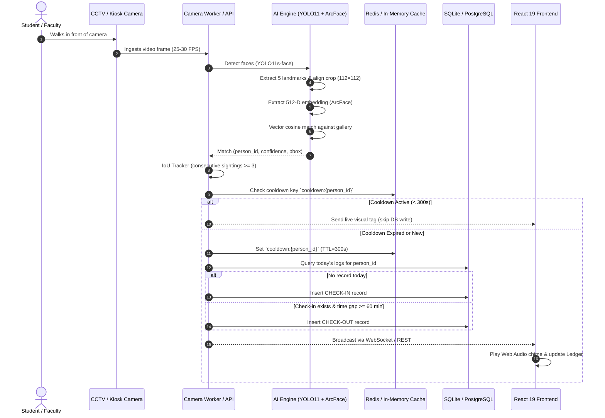

# Face Recognition Attendance System — Complete Architecture & Flow Guide

An enterprise-grade, real-time biometric face attendance system engineered for multi-camera CCTV/RTSP entrance feeds, USB webcams, and browser kiosks. Built with **FastAPI**, **YOLO11s-face**, **InsightFace (ArcFace 512-D)**, **SQLite / PostgreSQL**, and a modern **React 19 + Vite** dashboard styled with the **Vantage Design System**.

---

## Table of Contents
1. [High-Level Architecture & End-to-End Flow](#1-high-level-architecture--end-to-end-flow)
2. [Detailed Step-by-Step Processing Flow](#2-detailed-step-by-step-processing-flow)
3. [Academic Institution Architecture & Taxonomy](#3-academic-institution-architecture--taxonomy)
4. [Vantage UI Design System Specifications](#4-vantage-ui-design-system-specifications)
5. [Project Directory Structure](#5-project-directory-structure)
6. [Identity Enrollment & Registration Flow](#6-identity-enrollment--registration-flow)
7. [Real-Time Recognition & Attendance State Machine](#7-real-time-recognition--attendance-state-machine)
8. [Quickstart & Run Guide](#8-quickstart--run-guide)
9. [API Reference & WebSocket Specification](#9-api-reference--websocket-specification)
10. [Configuration & Tuning Parameters](#10-configuration--tuning-parameters)
11. [Enterprise Resilience & Edge Case Handling](#11-enterprise-resilience--edge-case-handling)

---

## 1. High-Level Architecture & End-to-End Flow

```
┌─────────────────────────────────────────────────────────────────────────────────────────────────┐
│                                       INPUT SOURCES                                             │
│       RTSP / CCTV IP Cameras     │     USB / Laptop Webcams     │     Browser Kiosk Upload      │
└─────────────────────────────────┬───────────────────────────────────────────────────────────────┘
                                  │ Raw Frames (BGR, 25–30 FPS)
                                  ▼
┌─────────────────────────────────────────────────────────────────────────────────────────────────┐
│ 1. FACE DETECTION                                                                               │
│    • Model: YOLO11s-face (anchor-free detector, imgsz=640, conf_thresh=0.50)                    │
│    • Handles simultaneous multi-face detection in high-density crowd scenarios                  │
│    • Output: Bounding Boxes [x1, y1, x2, y2] + Detection Confidence Scores                      │
└─────────────────────────────────┬───────────────────────────────────────────────────────────────┘
                                  │ Detected Face Crops + Bounding Boxes
                                  ▼
┌─────────────────────────────────────────────────────────────────────────────────────────────────┐
│ 2. ALIGNMENT & QUALITY ASSURANCE                                                                │
│    • 5-Point Landmark Extraction (MediaPipe FaceMesh: eyes, nose, mouth corners)                │
│    • Affine Similarity Transform: Warps faces to canonical 112×112 ArcFace coordinate frame     │
│    • Quality Gate: Laplacian variance blur filter (threshold > 40.0)                            │
│    • Pose Estimation: Frontal orientation bounds (Yaw ≤ 0.35, Roll ≤ 25°)                       │
│    • Illumination Compensation: CLAHE histogram equalization when mean luminance < 70.0        │
└─────────────────────────────────┬───────────────────────────────────────────────────────────────┘
                                  │ Aligned 112×112 Normalized Face Crops
                                  ▼
┌─────────────────────────────────────────────────────────────────────────────────────────────────┐
│ 3. DEEP FEATURE EMBEDDING                                                                       │
│    • Model: InsightFace buffalo_l (w600k_r50 ArcFace backbone)                                  │
│    • Output: L2-normalized 512-dimensional floating-point embedding vector                      │
│    • Property: Euclidean distance directly maps to angular cosine similarity                    │
└─────────────────────────────────┬───────────────────────────────────────────────────────────────┘
                                  │ 512-D Unit Embedding Vector
                                  ▼
┌─────────────────────────────────────────────────────────────────────────────────────────────────┐
│ 4. BIOMETRIC GALLERY MATCHING                                                                   │
│    • Vector Database: In-memory NumPy matrix dot product / FAISS Index                         │
│    • Similarity Metric: Cosine Similarity = (u · v) / (||u|| * ||v||)                           │
│    • Strict Cutoff: match_threshold = 0.45                                                      │
│    • Decision: argmax(cosine_similarity) ≥ 0.45 → Matched Identity; else → "Unknown"            │
└─────────────────────────────────┬───────────────────────────────────────────────────────────────┘
                                  │ Match Result (person_id, name, score)
                                  ▼
┌─────────────────────────────────────────────────────────────────────────────────────────────────┐
│ 5. TEMPORAL TRACKING & CONFIRMATION                                                             │
│    • IoU Multi-Face Tracker (track_iou=0.30, max_age=15 frames)                                 │
│    • N-Frame Sighting Confirmation: Requires 3 consecutive matching frames to prevent glitches  │
│    • Optional Eye Aspect Ratio (EAR) blink detection for passive anti-spoofing                  │
└─────────────────────────────────┬───────────────────────────────────────────────────────────────┘
                                  │ Confirmed Biometric Sighting
                                  ▼
┌─────────────────────────────────────────────────────────────────────────────────────────────────┐
│ 6. ANTI-DUPLICATE GUARD & COOLDOWN CACHE                                                        │
│    • Redis / In-Memory KV Cooldown Key: `cooldown:{person_id}` (TTL = 300 seconds)              │
│    • Prevents duplicate database writes while an employee or student stands near camera         │
└─────────────────────────────────┬───────────────────────────────────────────────────────────────┘
                                  │ Cooldown Passed
                                  ▼
┌─────────────────────────────────────────────────────────────────────────────────────────────────┐
│ 7. ATTENDANCE CLASSIFICATION & PERSISTENCE                                                      │
│    • Mode Check: Camera specific ('check_in' / 'check_out' / 'auto')                            │
│    • Auto Mode Logic:                                                                           │
│        - First confirmed sighting of the day → Log CHECK-IN                                     │
│        - Subsequent sighting after min_checkout_gap_min (60m) → Log CHECK-OUT                   │
│    • Database: SQLite (`db/attendance.db`) or PostgreSQL (unique index per person/date/kind)    │
│    • Snapshot Archival: Optional face crop stored under `db/snapshots/`                         │
└─────────────────────────────────┬───────────────────────────────────────────────────────────────┘
                                  │ Real-time Event Broadcast
                                  ▼
┌─────────────────────────────────────────────────────────────────────────────────────────────────┐
│ 8. REAL-TIME BROADCAST & USER INTERFACE                                                         │
│    • FastAPI Backend (:8000) REST APIs + WebSocket Stream (`/stream/{camera_id}`)               │
│    • React 19 Frontend Dashboard (:5173) styled with Vantage Design System:                     │
│        1. Live Scanner: Interactive camera HUD, bounding boxes, name tags, audio chimes         │
│        2. Attendance Ledger: Searchable logs, Degree & Dept filters, CSV/Excel/Print exports    │
│        3. Personnel Registry: Student/Staff management & multi-photo ArcFace enrollment         │
│        4. Cameras Monitor: CCTV feeds, worker health, FPS telemetry, reconnect states           │
│        5. Diagnostic Settings: API keys, system caches, ArcFace gallery rebuild                 │
└─────────────────────────────────────────────────────────────────────────────────────────────────┘
```

---

## 2. Detailed Step-by-Step Processing Flow

### Sequence Diagram


---

## 3. Academic Institution Architecture & Taxonomy

The system is configured out-of-the-box for institutional deployment (e.g., **Nadar Saraswathi College of Engineering and Technology — NSCET**), supporting hierarchical degree and department filtering across all screens and reports:

### Academic Taxonomy
- **Undergraduate Degrees (BE)**:
  - `CSE` — Computer Science and Engineering
  - `CIVIL` — Civil Engineering
  - `MECH` — Mechanical Engineering
  - `ECE` — Electronics and Communication Engineering
  - `EEE` — Electrical and Electronics Engineering
- **Undergraduate Degrees (B.Tech)**:
  - `IT` — Information Technology
  - `AIDS` — Artificial Intelligence and Data Science

### Institutional Features
1. **Dependent Dropdown Filtering**: Selecting a Degree dynamically narrows down the available Departments in all filters, enrollment modals, and exports.
2. **Printable Attendance Ledger Sheet**: Formatted official document modal with college header, academic department breakdown, date stamp, and dean/faculty signature rows (`window.print()`).
3. **Institutional Email Restriction**: User logins can be locked to official college domain email addresses (e.g., `@nscet.edu.in`).
4. **Standardized Process Labels**: Every system process follows a clear descriptive format (e.g., `"Enrollment Validation — Verifies face resolution, blur variance, and single-face constraints"`).

---

## 4. Vantage UI Design System Specifications

The frontend implements the **Vantage Design System** built with **React 19**, **Tailwind CSS v4**, and **TanStack Router**:

### Curated Color Palette
- **Sidebar Background**: Dark Teal `#06231d` (`var(--sidebar-bg)`)
- **Active Navigation / Indicator**: `#0a342c` with a 3px emerald accent bar flush with right edge
- **Primary Accent**: Emerald `#0E7A5F` (`var(--primary)`) / Hover: `#0B614B`
- **Surface**: Pure White `#FFFFFF` on Page Canvas `#F8FAF9`
- **Hairline Borders**: Soft Sage `#E5EAE7` (`var(--v-border)`) with zero heavy drop shadows (`shadow-xs` / `shadow-sm`)
- **Status Indicators**:
  - Check-In: Emerald Soft `#E8F5F1` with Emerald text `#0E7A5F`
  - Check-Out: Amber Soft `#FEF3C7` with Amber text `#92400E`
  - Danger / Error: Rose `#DC2626`

### Typography Hierarchy & Alignment Standards
| Class | Font Family | Size / Line-Height | Tracking | Usage |
| :--- | :--- | :--- | :--- | :--- |
| `.t-h1` | Plus Jakarta Sans | `40px / 1.05` | `-0.025em` | Page Titles |
| `.t-title` | Plus Jakarta Sans | `20px / 1.25` | `-0.015em` | Card Headers & Section Titles |
| `.t-kpi` | Plus Jakarta Sans | `36px / 1.1` | `-0.02em` | Metric Numbers (Tabular figures) |
| `.t-body` | Inter | `14px / 1.45` | `normal` | General descriptions & table data |
| `.t-small` | Inter | `12px / 1.35` | `normal` | Secondary subtitles, helper labels |
| `.t-eyebrow` | Inter | `11px / 1.2` | `0.08em` | Uppercase category markers |
| `.t-mono-xs` | JetBrains Mono | `11px / 1.2` | `normal` | Timestamps, IDs, Confidence %, Badges |

> **Alignment Guarantee**: All flex rows mixing icons, badges, numbers, and labels enforce optical vertical centering using `items-center`, `leading-none`, and `inline-flex` to eliminate baseline descent or text sagging.

---

## 5. Project Directory Structure

```
face_attendance/
├── backend/                      # Python FastAPI AI Engine & Face Recognition
│   ├── app/                      # Application core code
│   │   ├── alignment/            # 5-point similarity transformation & FaceMesh landmarks
│   │   ├── api/                  # FastAPI routers (auth, persons, recognize, attendance, stream)
│   │   ├── core/                 # Config loader (Pydantic Settings), security, college branding
│   │   ├── db/                   # SQLAlchemy models, session factory & SQLite/Postgres repository
│   │   ├── detection/            # YOLO11s-face, MTCNN & MediaPipe detector wrappers
│   │   ├── liveness/             # EAR (Eye Aspect Ratio) passive blink detection
│   │   ├── recognition/          # InsightFace ArcFace embedder, vector gallery & cosine matcher
│   │   ├── schemas/              # Pydantic request & response schemas
│   │   ├── services/             # Container, registration, recognition & attendance services
│   │   ├── tracking/             # IoU-based multi-face tracker across frames
│   │   ├── utils/                # Image decoding, CLAHE, metrics & KV cache abstraction
│   │   ├── video/                # OpenCV camera reader & RTSP stream processor
│   │   └── worker.py             # Background continuous multi-camera runner
│   ├── models/                   # Neural network weights
│   │   ├── insightface/          # ArcFace buffalo_l models (w600k_r50, det_10g, etc.)
│   │   └── yolov11s-face.pt      # YOLO11s face detection weights (19 MB)
│   ├── scripts/                  # Utilities (seed_data, download_models, evaluate, benchmark)
│   ├── tests/                    # Comprehensive unit & integration test suite (pytest)
│   ├── requirements.txt          # Python dependencies
│   ├── config.yaml               # Backend runtime configuration
│   └── .env                      # Backend environment variables
│
├── frontend/                     # Modern React 19 Web Dashboard
│   ├── src/
│   │   ├── components/           # Feature views:
│   │   │   ├── ScannerView.tsx   # Interactive webcam scanner & pipeline telemetry
│   │   │   ├── AttendanceView.tsx# Verification ledger, filters & print modal
│   │   │   ├── PersonnelView.tsx # Staff/student roster & multi-photo enrollment
│   │   │   ├── CamerasView.tsx   # CCTV feeds & background worker monitors
│   │   │   ├── LoginModal.tsx    # College authentication & quick demo switcher
│   │   │   ├── SettingsModal.tsx # System diagnostics & token configuration
│   │   │   └── ui/               # Primitive UI components (button, badge, card, input, etc.)
│   │   ├── lib/                  # Typed API client (`api.ts`), college taxonomy (`college.ts`)
│   │   ├── routes/               # TanStack Router routes (`index.tsx`, `__root.tsx`)
│   │   ├── styles.css            # Vantage design system tokens, typography & animations
│   │   └── main.tsx              # React application entry point
│   ├── package.json              # Frontend npm dependencies
│   ├── vite.config.ts            # Vite config with backend API proxy (/api -> :8000)
│   └── tsconfig.json             # TypeScript configuration
│
├── db/                           # Database Directory
│   ├── attendance.db             # SQLite database containing seeded personnel & logs
│   ├── snapshots/                # Captured face crop snapshots
│   └── raw/                      # Optional raw enrollment images
│
├── docker-compose.yml            # Multi-container production deployment
├── package.json                  # Unified root script runner
└── README.md                     # Complete Architecture & Flow Guide
```

---

## 6. Identity Enrollment & Registration Flow

```
Admin Form Input (Code, Name, Degree, Dept, 3–10 Photos)
                           │
                           ▼
              ┌──────────────────────────┐
              │  Multi-Image Validation  │
              └────────────┬─────────────┘
                           │ For each image:
                           ├─► 1. Exactly 1 face detected (Multi-face rejected)
                           ├─► 2. Min face bounding box ≥ 80px
                           ├─► 3. Blur variance (Laplacian) > 40.0
                           └─► 4. Frontal pose: Yaw ≤ 0.35, Roll ≤ 25°
                           │
                           ▼
              ┌──────────────────────────┐
              │ 5-Point MediaPipe Warp   │
              │  to 112×112 Canonical   │
              └────────────┬─────────────┘
                           │
                           ▼
              ┌──────────────────────────┐
              │ ArcFace 512-D Embedding  │
              │   L2-Vector Normalization│
              └────────────┬─────────────┘
                           │
                           ▼
              ┌──────────────────────────┐
              │ Duplicate Identity Guard │
              └────────────┬─────────────┘
                           │ Cosine similarity vs existing gallery:
                           ├─► If max(similarity) > 0.65 → REJECT (HTTP 409 Conflict)
                           └─► If max(similarity) ≤ 0.65 → ACCEPT
                           │
                           ▼
              ┌──────────────────────────┐
              │ Store DB & Rebuild Index │
              └──────────────────────────┘
              Write Person & Vectors to DB
              Trigger `gallery.rebuild()` in-memory (Zero server restart needed)
```

---

## 7. Real-Time Recognition & Attendance State Machine

When a person appears before an entrance camera or browser kiosk scanner:

```
                  ┌───────────────────────────────┐
                  │ Face Sighting in Video Stream │
                  └───────────────┬───────────────┘
                                  │
                                  ▼
                  ┌───────────────────────────────┐
                  │   IoU Track Confirmation      │
                  │   (≥ 3 Consecutive Frames)    │
                  └───────────────┬───────────────┘
                                  │
                                  ▼
                  ┌───────────────────────────────┐
                  │  Cosine Match Score ≥ 0.45?   │
                  └───────┬───────────────┬───────┘
                     No   │               │ Yes
             ┌────────────┘               └─────────────┐
             ▼                                          ▼
      [Mark as UNKNOWN]                     ┌───────────────────────┐
      Red bounding box                      │ Check Cooldown Key    │
      No DB write                           │ `cooldown:{person_id}`│
                                            └───────┬───────┬───────┘
                                       Active (<300s)│       │ Expired / None
                                 ┌──────────────────┘       └─────────────┐
                                 ▼                                        ▼
                         [Visual HUD Tag]                        [Set Cooldown TTL=300s]
                         Skip duplicate DB write                          │
                                                                          ▼
                                                         ┌────────────────────────────────┐
                                                         │ Check Today's DB Records       │
                                                         └────────┬──────────────┬────────┘
                                                    No Record     │              │ Has Check-In
                                                                  ▼              ▼
                                                          [Log CHECK-IN]   Elapsed ≥ 60m?
                                                                           ├─ Yes ──► [Log CHECK-OUT]
                                                                           └─ No  ──► [Skip write]
```

---

## 8. Quickstart & Run Guide

### Prerequisites
- **Python 3.11+**
- **Node.js 18+** & **npm**

### Step 1: Install Dependencies
```bash
# Backend virtual environment:
.\.venv\Scripts\activate
pip install -r backend/requirements.txt

# Frontend dependencies:
cd frontend
npm install
cd ..
```

### Step 2: Download AI Model Weights (One-Time Setup)
```bash
python backend/scripts/download_models.py
```
*Automatically downloads `yolov11s-face.pt` (19 MB) and InsightFace `buffalo_l` (288 MB).*

### Step 3: Run the Application
Open separate terminal tabs from the project root:

```bash
# Terminal 1: Start React Frontend Dashboard (Port 5173)
npm run dev

# Terminal 2: Start FastAPI AI Backend (Port 8000)
npm run backend

# Terminal 3 (Optional): Start Multi-Camera Background Worker
npm run worker
```

Open **[http://localhost:5173/](http://localhost:5173/)** in your browser.

### Default Demo Credentials
| Role | Email | Password | Permissions |
| :--- | :--- | :--- | :--- |
| **System Admin** | `admin@nscet.edu.in` | `admin123` | Full access: Enrollment, Deletion, Settings & Logs |
| **Faculty** | `faculty@nscet.edu.in` | `faculty123` | View Attendance Ledger, Print Sheets & Export Reports |

---

## 9. API Reference & WebSocket Specification

Interactive OpenAPI documentation is accessible at **`http://127.0.0.1:8000/docs`**. Include header `X-API-Key: change-me-please` or `Authorization: Bearer <JWT>` for authenticated routes.

### Authentication & Accounts
| Method | Endpoint | Description |
| :--- | :--- | :--- |
| `POST` | `/auth/login` | Authenticate with institutional credentials to obtain JWT token |
| `GET` | `/auth/me` | Fetch active user profile, name, role, and permissions |
| `GET` | `/auth/college-info` | Retrieve institutional branding, degree options, and metadata |

### Identity Management
| Method | Endpoint | Description |
| :--- | :--- | :--- |
| `GET` | `/persons` | List enrolled personnel (pagination, degree, department filters) |
| `POST` | `/persons/register` | Multipart enrollment (code, name, degree, dept, 3–10 face crops) |
| `GET` | `/persons/{id}` | Retrieve individual personnel details and photo count |
| `PUT` | `/persons/{id}` | Update personal information or academic department |
| `DELETE` | `/persons/{id}` | Delete identity and purge 512-D embeddings from gallery |

### Recognition & Attendance
| Method | Endpoint | Description |
| :--- | :--- | :--- |
| `POST` | `/recognize` | Ingests video frame; detects, aligns, embeds & matches faces (`mark=true` commits to DB) |
| `GET` | `/attendance` | Query attendance ledger (filters: date, degree, department, kind, person) |
| `GET` | `/attendance/daily-counts` | Daily attendance trends for analytics dashboards |
| `GET` | `/attendance/export` | Download filtered records as formatted `.csv` or `.xlsx` |

### Multi-Camera & Streaming
| Method | Endpoint | Description |
| :--- | :--- | :--- |
| `GET` | `/cameras` | List configured CCTV channels, RTSP streams, and worker health |
| `GET` | `/stream/{camera_id}/frame`| Fetch latest processed JPEG snapshot for a camera feed |
| `WS` | `/stream/{camera_id}` | Real-time WebSocket delivering frames and bounding box metadata |
| `GET` | `/health` | System diagnostics (database status, cache state, gallery size) |

---

## 10. Configuration & Tuning Parameters

Configurable in `backend/config.yaml` or `.env`:

| Parameter | Default | Recommended Range | Description |
| :--- | :--- | :--- | :--- |
| `match_threshold` | `0.45` | `0.42 – 0.52` | Cosine similarity cutoff. Higher values prevent false positives; lower values improve recognition under harsh lighting. |
| `duplicate_threshold` | `0.65` | `0.60 – 0.70` | Threshold for rejecting duplicate enrollments under different names. |
| `confirm_frames` | `3` | `2 – 5` | Number of consecutive matching sightings required before marking attendance. |
| `attendance_cooldown_s` | `300` | `180 – 600` | Cooldown in seconds before the same person can trigger another log. |
| `min_checkout_gap_min` | `60` | `30 – 120` | Minimum gap in minutes between check-in and check-out in `auto` mode. |
| `blur_threshold` | `40.0` | `30.0 – 60.0` | Minimum Laplacian variance on face crops to reject blurry frames. |
| `min_face_px` | `80` | `60 – 112` | Minimum face width/height in pixels to be processed. |

---

## 11. Enterprise Resilience & Edge Case Handling

1. **Simultaneous Multi-Face Ingestion**: YOLO11s-face detects all faces in a single forward pass. Each face is cropped, aligned, and matched independently against the vector gallery in parallel.
2. **Extreme Low-Light / Glare**: CLAHE (Contrast Limited Adaptive Histogram Equalization) automatically balances luminance when mean face intensity drops below `70.0`.
3. **Camera Stream Dropouts**: The CCTV background worker monitors RTSP/HTTP connections and auto-reconnects using exponential backoff without interrupting running services.
4. **Redis Failover**: If Redis becomes unavailable, the system transparently falls back to an in-memory thread-safe LRU Key-Value cache.
5. **Database Connection Health**: SQLAlchemy pre-ping verification checks pool liveness before queries, auto-recovering from dropped database connections.
