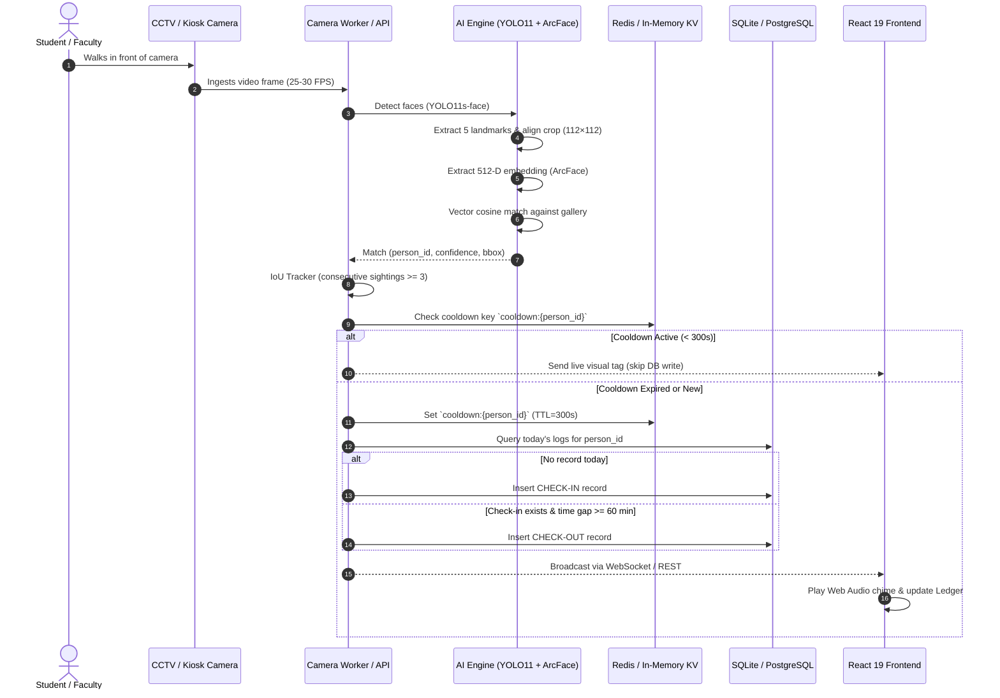

<div align="center">

# 🎓 NSCET Face Recognition Attendance System
### Enterprise Real-Time Biometric Attendance & Identity Intelligence Platform

[](https://python.org)
[](https://fastapi.tiangolo.com)
[](https://pytorch.org)
[](https://github.com/ultralytics/ultralytics)
[](https://github.com/deepinsight/insightface)
[](https://react.dev)
[](https://vitejs.dev)
[](https://tailwindcss.com)
[](#)

<p align="center">
  <b>Developed for Nadar Saraswathi College of Engineering and Technology (NSCET)</b><br>
  High-throughput, real-time facial recognition attendance system supporting multi-camera CCTV/RTSP entrance feeds, USB webcams, browser kiosks, automated check-in/out state machines, intra-day flow analytics, and complete academic identity roster management.
</p>

---

</div>

## 📑 Table of Contents

1. [Entire Tech Stack Specification](#1-entire-tech-stack-specification)
2. [Key System Features & Modules](#2-key-system-features--modules)
3. [High-Level Architecture & End-to-End Pipeline](#3-high-level-architecture--end-to-end-pipeline)
4. [Detailed Biometric Processing Flow](#4-detailed-biometric-processing-flow)
5. [Academic Institution Architecture & Taxonomy (NSCET)](#5-academic-institution-architecture--taxonomy-nscet)
6. [Vantage UI Design System Specifications](#6-vantage-ui-design-system-specifications)
7. [Project Directory & File Structure](#7-project-directory--file-structure)
8. [Quickstart & Run Guide](#8-quickstart--run-guide)
9. [API Reference & WebSocket Specification](#9-api-reference--websocket-specification)
10. [Configuration & Tuning Parameters](#10-configuration--tuning-parameters)
11. [Testing & Quality Assurance](#11-testing--quality-assurance)
12. [Enterprise Resilience & Security Guardrails](#12-enterprise-resilience--security-guardrails)

---

## 1. Entire Tech Stack Specification

The system is engineered using a decoupled, production-grade microservices architecture combining cutting-edge Computer Vision deep learning with an asynchronous backend and an ultra-responsive modern frontend.

### 🌐 Frontend Layer
| Component | Technology | Version | Purpose & Description |
| :--- | :--- | :--- | :--- |
| **Framework** | **React** | `19.2.0` | Declarative, component-driven reactive user interface |
| **Build Tool & Bundler** | **Vite** | `8.1.5` | Lightning-fast HMR dev server and optimized rollup production bundler |
| **Language** | **TypeScript** | `5.8.3` | Type-safe development with strict type inference across routes and payloads |
| **Client-side Routing** | **TanStack Router** | `1.170.41` | Fully type-safe client router with search-param state persistence and code splitting |
| **Router Vite Plugin** | **@tanstack/router-plugin** | `1.168.42` | Auto-generation of typed route trees (`routeTree.gen.ts`) |
| **Data Fetching & Cache** | **TanStack Query** | `5.101.1` | Asynchronous server-state synchronization, background refetching, and caching |
| **CSS & Design System** | **Tailwind CSS** | `4.2.1` | Next-gen CSS engine using `@tailwindcss/vite` with custom HSL CSS tokens |
| **UI Primitives** | **Radix UI** | `1.x` | Accessible headless components (`Dialog`, `AlertDialog`, `Tooltip`, `Slot`) |
| **Component Variants** | **Class Variance Authority** | `0.7.1` | Structured type-safe UI variants for buttons, badges, cards, and tabs |
| **Class Merging** | **clsx & tailwind-merge** | `2.1` / `3.5` | Conflict-free conditional CSS utility classes |
| **Iconography** | **Lucide React** | `0.575.0` | Comprehensive, consistent SVG icon set |
| **Toast Notifications** | **Sonner** | `2.0.7` | Rich, animated, stacked notification toasts |
| **Date Formatting** | **date-fns** | `4.1.0` | Modular time and date formatting for intra-day records and logs |
| **Runtime Validation** | **Zod** | `3.25.76` | Client-side schema validation for form submissions and query parameters |
| **Testing** | **Vitest & Testing Library** | `4.1.10` / `16.0` | Unit and integration testing for UI components and routing |

---

### ⚙️ Backend & API Layer
| Component | Technology | Version | Purpose & Description |
| :--- | :--- | :--- | :--- |
| **Web Framework** | **FastAPI** | `0.115.6` | High-performance, async Python web API framework with automatic OpenAPI docs |
| **ASGI Web Server** | **Uvicorn** | `0.32.1` | Production-grade ASGI server with `uvloop` and `httptools` acceleration |
| **Language Runtime** | **Python** | `3.11+` | Core execution environment with native typing and asynchronous concurrency |
| **Settings & Validation**| **Pydantic v2 & Pydantic-Settings** | `2.10.3` | Strict request/response modeling and environment variable validation |
| **Database ORM** | **SQLAlchemy** | `2.0.36` | Modern 2.0-style async/sync ORM with connection pooling |
| **Database Engines** | **SQLite / PostgreSQL** | `3.x / 16.x` | SQLite default for zero-config local run; PostgreSQL (`psycopg2-binary 2.9.10`) for production |
| **Schema Migrations** | **Alembic** | `1.14.0` | Database schema version control and automatic migration scripts |
| **Cache & KV Store** | **Redis** | `5.2.1` | Fast distributed attendance cooldown cache with automatic in-memory fallback |
| **Authentication** | **PyJWT & Passlib / Bcrypt**| `2.15` / `5.0` | JWT bearer token authorization and salted Bcrypt password hashing |
| **Data Wrangling** | **Pandas & NumPy** | `2.2.3` / `1.26.4` | Data aggregation, time-series flow curves, and vector transformations |
| **Report Exporting** | **OpenPyXL** | `3.1.5` | Generation of formatted Excel (`.xlsx`) files with institutional headers |
| **Logging** | **Loguru** | `0.7.3` | Structured, colorized, thread-safe asynchronous logging |
| **Testing Framework** | **PyTest & HTTPX** | `8.3.4` / `0.28.1`| Session-scoped integration and E2E workflow test runner |

---

### 🧠 Computer Vision & AI/ML Pipeline
| Model / Tool | Architecture / Weights | Purpose & Pipeline Role |
| :--- | :--- | :--- |
| **Face Detection** | **YOLO11s-face (Ultralytics 8.3.50)** | Anchor-free high-speed single-stage detector (`yolov11s-face.pt`, imgsz=640). Detects multiple faces in crowded entrances simultaneously. |
| **Alternative Detectors**| **MediaPipe FaceMesh & MTCNN** | Multi-face mesh landmark extraction & secondary detector fallbacks. |
| **Face Alignment** | **5-Point Affine Similarity Transform** | Canonical 112×112 ArcFace coordinate frame alignment using eye centers, nose tip, and mouth corners. |
| **Quality Filter** | **Laplacian Variance Blur Detection** | Filters out motion-blurred face crops (rejection threshold `variance < 40.0`). |
| **Illumination Filter** | **CLAHE Adaptive Equalization** | Contrast Limited Adaptive Histogram Equalization active when luminance `< 70.0`. |
| **Deep Feature Extractor**| **InsightFace ArcFace (w600k_r50)** | ResNet-50 backbone trained with Additive Angular Margin Loss, outputting unit-normalized **512-dimensional embeddings**. |
| **Inference Engines** | **PyTorch 2.2 / ONNX Runtime 1.20**| CPU / CUDA GPU accelerated model inference with automatic device detection. |
| **Vector Search** | **NumPy Vectorized Dot Product / FAISS**| Sub-millisecond cosine similarity search across thousands of enrolled identities. |
| **Temporal Tracker** | **IoU (Intersection-over-Union)** | Multi-face tracking across frames to maintain trajectory and eliminate frame flickering. |
| **Anti-Spoofing** | **EAR (Eye Aspect Ratio) & Liveness** | Passive blink tracking and texture consistency checks to deter photo replay attacks. |

---

### 🚢 DevOps, Infrastructure & Runtime
| Tool | Configuration | Role |
| :--- | :--- | :--- |
| **Containerization** | **Docker & Docker Compose** | Multi-stage Dockerfile bundling FastAPI backend, AI dependencies, and static frontend. |
| **Process Management**| **Multi-camera Worker (`app.worker`)** | Standalone multi-threaded OpenCV video capture pipeline reading RTSP and USB feeds. |
| **Cross-Platform** | **Windows, Linux, macOS** | Seamless execution on Windows PowerShell and POSIX environments. |

---

## 2. Key System Features & Modules

```
┌──────────────────────────────────────────────────────────────────────────────────────────────────┐
│                                   NSCET ATTENDANCE DASHBOARD                                    │
├───────────────┬───────────────────┬───────────────────┬───────────────────┬──────────────────────┤
│ 📸 Live       │ 📊 Analytics &   │ 📋 Attendance     │ 👥 Personnel      │ ⚙️ System Settings   │
│    Scanner    │    Monitoring     │    Ledger         │    Directory      │    & Diagnostics     │
└───────────────┴───────────────────┴───────────────────┴───────────────────┴──────────────────────┘
```

### 1. 📸 Live Camera Scanner HUD (`ScannerView.tsx`)
- **Interactive Multi-Camera Video Feed**: Connects to USB webcams or remote RTSP streams.
- **Biometric HUD Overlay**: Real-time bounding boxes around detected faces with confidence badges and name tags.
- **Instant Audio & Visual Feedback**: Web Audio synthesized chime and toast feedback upon confirmed registration/check-in.
- **Live Pipeline Diagnostics**: Displays detector inference time, alignment latency, embedding latency, and active FPS telemetry.

### 2. 📊 Analytics & Monitoring (`DataExplorerView.tsx`)
- **Telemetry Overview Cards**: Total attendance, on-time arrivals, late entries (past 09:15 cutoff), and active camera counts.
- **Intra-Day Flow Curves**: Hourly arrival and departure trajectories (8:00 AM – 6:00 PM).
- **Departmental Flow Analysis**: Distribution breakdown across CSE, AIDS, ECE, EEE, MECH, and CIVIL.
- **Identity Telemetry Table**: Real-time log of verified identities with similarity scores and camera origins.

### 3. 📋 Attendance Ledger & Verification (`AttendanceView.tsx`)
- **Multi-Parameter Search & Filter**: Filter records by Date, Degree (B.E. / B.Tech), Academic Department, Event Type (`check_in` / `check_out`), or Student Name/Roll Number.
- **Export Capabilities**:
  - **CSV Report**: Instant download with institutional headers.
  - **Excel Workbook (`.xlsx`)**: Formatted binary Excel workbook created via OpenPyXL.
  - **Printable Ledger Sheet**: Formatted official college paper modal with college seal, department breakdown, date stamp, and Dean/HOD signature blocks (`window.print()`).

### 4. 👥 Personnel Management & Enrollment (`PersonnelView.tsx`)
- **Student & Staff Directory**: Searchable list with avatar previews, roll numbers, degrees, departments, and vector sample counts.
- **High-Quality Multi-Photo Enrollment**:
  - Upload 3 to 10 photos per individual.
  - **Automated Quality Gate**: Checks for single-face constraint, minimum resolution (`>= 80px`), blur variance, and frontal pose.
  - **Duplicate Face Guard**: Cross-matches face embeddings against the entire database. Rejects duplicate registrations with HTTP 409 Conflict if similarity exceeds `0.65`.
  - **Automatic Gallery Rebuild**: Re-indexes vector embeddings instantly without requiring a server restart.

### 5. 📹 Camera Telemetry & Stream Manager (`CamerasView.tsx`)
- **Multi-Camera Grid**: View simultaneous feeds across Entrance Gate, Library, Lab, and Canteen channels.
- **Worker Telemetry**: Live indicators showing camera status (`online`, `reconnecting`, `error`), FPS counters, and processed frame totals.

### 6. ⚙️ System Settings & Diagnostics (`SettingsView.tsx` & `SettingsModal.tsx`)
- **Live Recognition Strictness Slider**: Adjust match threshold (`0.30 – 0.70`, default `0.45`).
- **Cooldown & Checkout Cutoffs**: Configurable cooldown seconds (`300s`) and minimum checkout gap (`60 min`).
- **Camera Channel Management**: Add, modify, or remove RTSP streams and USB camera indices on-the-fly (`backend/db/settings.json`).
- **One-Click Gallery Rebuild**: Rebuilds the ArcFace vector index directly from SQLite/PostgreSQL in memory.

---

## 3. High-Level Architecture & End-to-End Pipeline

```
┌─────────────────────────────────────────────────────────────────────────────────────────────────┐
│                                       INPUT SOURCES                                             │
│       RTSP / CCTV IP Cameras     │     USB / Laptop Webcams     │     Browser Kiosk Upload      │
└─────────────────────────────────┬───────────────────────────────────────────────────────────────┘
                                  │ Raw Frames (BGR, 25–30 FPS)
                                  ▼
┌─────────────────────────────────────────────────────────────────────────────────────────────────┐
│ 1. FACE DETECTION                                                                               │
│    • Model: YOLO11s-face (anchor-free detector, imgsz=640, conf_thresh=0.50)                    │
│    • Handles simultaneous multi-face detection in high-density crowd scenarios                  │
│    • Output: Bounding Boxes [x1, y1, x2, y2] + Detection Confidence Scores                      │
└─────────────────────────────────┬───────────────────────────────────────────────────────────────┘
                                  │ Detected Face Crops + Bounding Boxes
                                  ▼
┌─────────────────────────────────────────────────────────────────────────────────────────────────┐
│ 2. ALIGNMENT & QUALITY ASSURANCE                                                                │
│    • 5-Point Landmark Extraction (MediaPipe FaceMesh: eyes, nose, mouth corners)                │
│    • Affine Similarity Transform: Warps faces to canonical 112×112 ArcFace coordinate frame     │
│    • Quality Gate: Laplacian variance blur filter (threshold > 40.0)                            │
│    • Pose Estimation: Frontal orientation bounds (Yaw ≤ 0.35, Roll ≤ 25°)                       │
│    • Illumination Compensation: CLAHE histogram equalization when mean luminance < 70.0        │
└─────────────────────────────────┬───────────────────────────────────────────────────────────────┘
                                  │ Aligned 112×112 Normalized Face Crops
                                  ▼
┌─────────────────────────────────────────────────────────────────────────────────────────────────┐
│ 3. DEEP FEATURE EMBEDDING                                                                       │
│    • Model: InsightFace buffalo_l (w600k_r50 ArcFace backbone)                                  │
│    • Output: L2-normalized 512-dimensional floating-point embedding vector                      │
│    • Property: Euclidean distance directly maps to angular cosine similarity                    │
└─────────────────────────────────┬───────────────────────────────────────────────────────────────┘
                                  │ 512-D Unit Embedding Vector
                                  ▼
┌─────────────────────────────────────────────────────────────────────────────────────────────────┐
│ 4. BIOMETRIC GALLERY MATCHING                                                                   │
│    • Vector Database: In-memory NumPy matrix dot product / FAISS Index                         │
│    • Similarity Metric: Cosine Similarity = (u · v) / (||u|| * ||v||)                           │
│    • Strict Cutoff: match_threshold = 0.45                                                      │
│    • Decision: argmax(cosine_similarity) ≥ 0.45 → Matched Identity; else → "Unknown"            │
└─────────────────────────────────┬───────────────────────────────────────────────────────────────┘
                                  │ Match Result (person_id, name, score)
                                  ▼
┌─────────────────────────────────────────────────────────────────────────────────────────────────┐
│ 5. TEMPORAL TRACKING & CONFIRMATION                                                             │
│    • IoU Multi-Face Tracker (track_iou=0.30, max_age=15 frames)                                 │
│    • N-Frame Sighting Confirmation: Requires 3 consecutive matching frames to prevent glitches  │
│    • Optional Eye Aspect Ratio (EAR) blink detection for passive anti-spoofing                  │
└─────────────────────────────────┬───────────────────────────────────────────────────────────────┘
                                  │ Confirmed Biometric Sighting
                                  ▼
┌─────────────────────────────────────────────────────────────────────────────────────────────────┐
│ 6. ANTI-DUPLICATE GUARD & COOLDOWN CACHE                                                        │
│    • Redis / In-Memory KV Cooldown Key: `cooldown:{person_id}` (TTL = 300 seconds)              │
│    • Prevents duplicate database writes while an employee or student stands near camera         │
└─────────────────────────────────┬───────────────────────────────────────────────────────────────┘
                                  │ Cooldown Passed
                                  ▼
┌─────────────────────────────────────────────────────────────────────────────────────────────────┐
│ 7. ATTENDANCE CLASSIFICATION & PERSISTENCE                                                      │
│    • Mode Check: Camera specific ('check_in' / 'check_out' / 'auto')                            │
│    • Auto Mode Logic:                                                                           │
│        - First confirmed sighting of the day → Log CHECK-IN                                     │
│        - Subsequent sighting after min_checkout_gap_min (60m) → Log CHECK-OUT                   │
│    • Database: SQLite (`db/attendance.db`) or PostgreSQL (unique index per person/date/kind)    │
│    • Snapshot Archival: Optional face crop stored under `db/snapshots/`                         │
└─────────────────────────────────┬───────────────────────────────────────────────────────────────┘
                                  │ Real-time Event Broadcast
                                  ▼
┌─────────────────────────────────────────────────────────────────────────────────────────────────┐
│ 8. REAL-TIME BROADCAST & USER INTERFACE                                                         │
│    • FastAPI Backend (:8000) REST APIs + WebSocket Stream (`/stream/{camera_id}`)               │
│    • React 19 Frontend Dashboard (:5173) styled with Vantage Design System                      │
└─────────────────────────────────────────────────────────────────────────────────────────────────┘
```

---

## 4. Detailed Biometric Processing Flow



---

## 5. Academic Institution Architecture & Taxonomy (NSCET)

Configured out-of-the-box for **Nadar Saraswathi College of Engineering and Technology (NSCET)** with institutional hierarchy and validation rules:

### Academic Programs & Departments
- **Bachelor of Engineering (B.E.)**:
  - `CSE` — Computer Science and Engineering
  - `AIDS` — Artificial Intelligence and Data Science
  - `ECE` — Electronics and Communication Engineering
  - `EEE` — Electrical and Electronics Engineering
  - `MECH` — Mechanical Engineering
  - `CIVIL` — Civil Engineering
- **Bachelor of Technology (B.Tech)**:
  - `IT` — Information Technology
  - `AIDS` — Artificial Intelligence and Data Science

### Institutional Safeguards
1. **Dynamic Dependent Filters**: Selecting a Degree automatically restricts the Department dropdowns across all modals, search filters, and reports.
2. **Roll Number / Register ID Validation**: Unique register number indexing prevents conflicting student entries.
3. **Official College Seal & Logo**: Integrated asset at `frontend/public/assets/college-logo.png` featured on login screens, navigation bar, and printable documents.
4. **Official Domain Auth**: Restricts login access to validated institutional Google Workspace/Microsoft domains (e.g., `@nscet.edu.in`).

---

## 6. Vantage UI Design System Specifications

The dashboard uses the **Vantage Design System**, creating a focused, high-contrast, premium dark/light institutional experience:

### Curated Color Palette
- **Sidebar Background**: Deep Pine `#06231d` (`var(--sidebar-bg)`)
- **Active Navigation Indicator**: `#0a342c` with an emerald right-edge vertical bar
- **Primary Accent**: Emerald `#0E7A5F` (`var(--primary)`) / Hover: `#0B614B`
- **Surface Canvas**: Pure White `#FFFFFF` on Page Canvas `#F8FAF9`
- **Hairline Borders**: Soft Sage `#E5EAE7` (`var(--v-border)`) with subtle shadows
- **Status Badges**:
  - `Check-In`: Soft Emerald `#E8F5F1` with dark emerald text `#0E7A5F`
  - `Check-Out`: Soft Amber `#FEF3C7` with dark amber text `#92400E`
  - `Alert / Error`: Crimson `#DC2626`

### Typography Hierarchy
| Class | Font Family | Size / Leading | Usage |
| :--- | :--- | :--- | :--- |
| `.t-h1` | Plus Jakarta Sans | `40px / 1.05` | Main Dashboard Titles |
| `.t-title` | Plus Jakarta Sans | `20px / 1.25` | Section Headers & Card Titles |
| `.t-kpi` | Plus Jakarta Sans | `36px / 1.1` | Metric Numbers & Tabular KPI Counts |
| `.t-body` | Inter | `14px / 1.45` | Standard Descriptions & Table Records |
| `.t-small` | Inter | `12px / 1.35` | Helper Labels, Subtitles |
| `.t-mono-xs` | JetBrains Mono | `11px / 1.2` | Timestamps, Bounding Box Coords, Confidence % |

---

## 7. Project Directory & File Structure

```
face_attendance/
├── backend/                      # Python FastAPI AI Engine & Face Recognition
│   ├── app/                      # Application source code
│   │   ├── alignment/            # 5-point similarity transformation & FaceMesh landmarks
│   │   ├── api/                  # FastAPI routers (auth, persons, recognize, attendance, settings, stream)
│   │   ├── core/                 # Pydantic configuration, security, college taxonomy
│   │   ├── db/                   # SQLAlchemy models, SQLite/Postgres repository & sessions
│   │   ├── detection/            # YOLO11s-face, MTCNN & MediaPipe detector wrappers
│   │   ├── liveness/             # EAR passive blink tracking and liveness models
│   │   ├── recognition/          # InsightFace ArcFace embedder, gallery index & matcher
│   │   ├── schemas/              # Pydantic validation schemas
│   │   ├── services/             # Container, registration, recognition & attendance services
│   │   ├── tracking/             # IoU multi-face frame tracker
│   │   ├── utils/                # Image decoding, CLAHE equalization & KV store
│   │   ├── video/                # OpenCV camera reader & RTSP stream processor
│   │   └── worker.py             # Background continuous multi-camera runner
│   ├── alembic/                  # Database migration scripts
│   ├── db/                       # Persisted settings (settings.json) & local snapshots
│   ├── models/                   # Neural network weights (yolov11s-face.pt & buffalo_l)
│   ├── scripts/                  # Utilities (seed_data, download_models, create_admin)
│   ├── tests/                    # Test suite (test_e2e_workflow.py, test_api.py, etc.)
│   ├── requirements.txt          # Python dependencies
│   ├── config.yaml               # Backend runtime parameters
│   └── .env                      # Local environment configuration
│
├── frontend/                     # Modern React 19 Web Application
│   ├── src/
│   │   ├── components/           # Feature views:
│   │   │   ├── ScannerView.tsx   # Interactive webcam scanner & pipeline telemetry
│   │   │   ├── AttendanceView.tsx# Verification ledger, filters & print modal
│   │   │   ├── PersonnelView.tsx # Staff/student roster & multi-photo enrollment
│   │   │   ├── CamerasView.tsx   # CCTV feeds & background worker monitors
│   │   │   ├── DataExplorerView.tsx # Telemetry, intra-day flow curves & peak hour graphs
│   │   │   ├── SettingsView.tsx  # Dynamic settings & threshold controls
│   │   │   ├── SettingsModal.tsx # Quick diagnostic modal
│   │   │   ├── LoginModal.tsx    # College authentication & quick demo switcher
│   │   │   └── ui/               # Primitive UI components (button, badge, card, input, etc.)
│   │   ├── lib/                  # Typed API client (`api.ts`), college taxonomy (`college.ts`)
│   │   ├── routes/               # TanStack Router routes (`index.tsx`, `__root.tsx`)
│   │   ├── styles.css            # Vantage design system tokens, typography & animations
│   │   └── main.tsx              # React application entry point
│   ├── public/                   # Static assets (college-logo.png, icons, favicons)
│   ├── package.json              # Frontend npm dependencies
│   ├── vite.config.ts            # Vite config with backend API proxy (/api -> :8000)
│   └── tsconfig.json             # TypeScript configuration
│
├── db/                           # Shared Database Directory
│   ├── attendance.db             # Local SQLite database (gitignored)
│   ├── snapshots/                # Captured face crop snapshots (gitignored)
│   └── raw/                      # Optional raw enrollment images (gitignored)
│
├── docker-compose.yml            # Multi-container production deployment
├── package.json                  # Unified root script runner
├── .gitignore                    # Comprehensive repository ignore rules
└── README.md                     # System documentation & tech stack guide
```

---

## 8. Quickstart & Run Guide

### Prerequisites
- **Python 3.11+** installed
- **Node.js 18+** & **npm** installed
- (Optional) **CUDA-enabled GPU** for real-time multi-camera CCTV inferencing

---

### Step 1: Install Dependencies

#### 1. Backend Virtual Environment:
```powershell
# Create virtual environment (if not already created)
python -m venv .venv

# Activate virtual environment:
# Windows PowerShell:
.\.venv\Scripts\activate
# Linux / macOS:
source .venv/bin/activate

# Install Python requirements
pip install -r backend/requirements.txt
```

#### 2. Frontend Dependencies:
```powershell
cd frontend
npm install
cd ..
```

---

### Step 2: Download AI Model Weights (One-Time Setup)

```powershell
python backend/scripts/download_models.py
```
*This automatically downloads `yolov11s-face.pt` (19 MB) and InsightFace `buffalo_l` (288 MB) into the `backend/models/` directory.*

---

### Step 3: Run the Application

Open separate terminal windows from the project root:

```powershell
# Terminal 1: Start React 19 Frontend Dashboard (Port 5173)
npm run dev

# Terminal 2: Start FastAPI AI Backend (Port 8000)
npm run backend

# Terminal 3 (Optional): Start Multi-Camera Background RTSP Worker
npm run worker
```

Open your browser to: **[http://localhost:5173/](http://localhost:5173/)**

---

### Default Demo Credentials

| Role | Email | Password | Permissions |
| :--- | :--- | :--- | :--- |
| **System Admin** | `admin@nscet.edu.in` | `admin123` | Full access: Enrollment, Deletion, Settings, Gallery Rebuild & Logs |
| **Faculty / Staff** | `faculty@nscet.edu.in` | `faculty123` | View Attendance Ledger, Print Official Sheets & Export Reports |

---

## 9. API Reference & WebSocket Specification

Interactive OpenAPI Swagger documentation is available at **`http://127.0.0.1:8000/docs`**. Include header `X-API-Key: change-me-please` or `Authorization: Bearer <JWT>` for protected routes.

### Authentication & Profiles
| Method | Endpoint | Description |
| :--- | :--- | :--- |
| `POST` | `/auth/token` | Authenticate with institutional credentials to obtain JWT Bearer token |
| `GET` | `/auth/me` | Fetch active user profile, name, role, and permissions |
| `GET` | `/college/config` | Retrieve institutional branding, degree options, and department taxonomy |

### Personnel & Enrollment
| Method | Endpoint | Description |
| :--- | :--- | :--- |
| `GET` | `/persons` | List enrolled students and faculty (pagination, degree, department filters) |
| `POST` | `/register` | Multi-image face enrollment (name, code, degree, dept, year, 3–10 face images) |
| `GET` | `/persons/{id}` | Retrieve individual personnel details and photo vector count |
| `PUT` | `/persons/{id}` | Update personal information or academic department |
| `DELETE` | `/persons/{id}` | Delete identity and remove 512-D embeddings from gallery |

### Recognition & Attendance
| Method | Endpoint | Description |
| :--- | :--- | :--- |
| `POST` | `/recognize` | Ingests camera frame; detects, aligns, embeds & matches faces (`mark=true` commits to DB) |
| `GET` | `/attendance/today` | Fetch all attendance events logged for the current date |
| `GET` | `/attendance/daily-counts`| Hourly attendance trends for analytics dashboards |
| `GET` | `/attendance/export` | Download filtered records as formatted `.csv` or `.xlsx` |

### System Settings & Gallery
| Method | Endpoint | Description |
| :--- | :--- | :--- |
| `GET` | `/settings` | Retrieve active system thresholds, cooldown seconds, and camera channels |
| `POST` | `/settings` | Dynamically update thresholds and camera configs (persists to `settings.json`) |
| `POST` | `/gallery/rebuild` | Trigger in-memory ArcFace vector gallery synchronization from database |
| `GET` | `/health` | System diagnostics (database status, models loaded, gallery size, college info) |
| `WS` | `/stream/{camera_id}` | Real-time WebSocket delivering camera frames and bounding box metadata |

---

## 10. Configuration & Tuning Parameters

All settings can be configured via `backend/.env`, `backend/config.yaml`, or dynamically through the **Settings Dashboard**:

| Parameter | Default | Recommended Range | Description |
| :--- | :--- | :--- | :--- |
| `MATCH_THRESHOLD` | `0.45` | `0.42 – 0.52` | Cosine similarity cutoff. Higher values prevent false positives; lower values improve recognition under adverse lighting. |
| `DUPLICATE_THRESHOLD` | `0.65` | `0.60 – 0.70` | Rejects duplicate student enrollments under different names if similarity exceeds this value. |
| `CONFIRM_FRAMES` | `3` | `1 – 5` | Number of consecutive matching sightings required before marking attendance. |
| `ATTENDANCE_COOLDOWN_S`| `300` | `180 – 600` | Cooldown in seconds before the same person can trigger another check-in/out log. |
| `MIN_CHECKOUT_GAP_MIN` | `60` | `30 – 120` | Minimum gap in minutes between check-in and check-out in `auto` mode. |
| `BLUR_THRESHOLD` | `40.0` | `30.0 – 60.0` | Minimum Laplacian variance on face crops to reject blurry frames. |
| `MIN_FACE_PX` | `80` | `50 – 112` | Minimum face width/height in pixels to be accepted. |

---

## 11. Testing & Quality Assurance

The repository includes a comprehensive, multi-layer automated test suite:

### 1. End-to-End (E2E) Complete Workflow Test Suite
Covering the entire lifecycle from server health, institutional config, multi-photo enrollment, duplicate face rejection, live recognition, attendance persistence, CSV/Excel export, JWT auth, and gallery re-indexing:
```powershell
# Run the complete E2E workflow test suite
pytest backend/tests/test_e2e_workflow.py -v
```
```text
======================== 26 passed in 6.37s ========================
```

### 2. Full Backend Test Suite
```powershell
# Run all unit and integration tests
pytest backend/tests/ -q
```
```text
======================== 55 passed in 16.26s =======================
```

### 3. Frontend Production Build Verification
```powershell
cd frontend
npm run build
```
```text
✓ built in 1.71s with 0 errors
```

---

## 12. Enterprise Resilience & Security Guardrails

1. **Simultaneous Multi-Face Ingestion**: YOLO11s-face detects all faces in a single forward pass. Each face is cropped, aligned, and matched independently against the vector gallery in parallel.
2. **Adaptive Illumination (CLAHE)**: Automatically balances face crop contrast when mean luminance drops below `70.0` (ideal for morning/evening entrance lighting).
3. **Stream Auto-Reconnect**: Camera workers monitor RTSP/HTTP connections and auto-reconnect using exponential backoff without crashing the service.
4. **Transparent KV Failover**: If Redis is not configured or goes down, the system seamlessly uses an in-memory thread-safe LRU Key-Value store.
5. **Database Connection Liveness**: SQLAlchemy pre-ping verification checks pool liveness before queries, auto-recovering from dropped database connections.

---

<div align="center">
  <sub>© 2026 Nadar Saraswathi College of Engineering and Technology (NSCET). All rights reserved.</sub>
</div>
